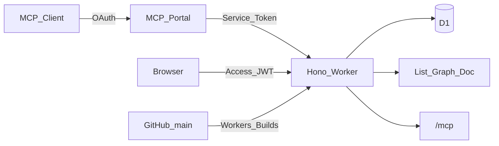

# tameru 詳細設計

**日付:** 2026-11-14  
**状態:** 設計承認済み（会話上の合意を文書化）

## 1. 目的

tameru は、コーディングエージェントが Markdown をため、必要に応じて探索し、人がブラウザで一覧・検索・グラフ・本文を眺めるための **個人開発のナレッジベース** である。

役割のイメージは Obsidian に近い。文書同士を `/d/{id}` リンクでゆるくつなぎ、グラフで「育つ」様子を見えるようにする。llm-wiki のような厳密な文書整理手法は採用しない。

参照する既存物（コピー元にはしない）:

- `~/repos/nagetsukeru/tsukeru` — 機能の芯（browse / search / get / リンク / グラフ）
- `~/repos/hirakawaxxx/knowledge-base` — Cloudflare Access + MCP Portal の運用
- `~/repos/hirakawaxxx/design-kit` — Soft Mint 系の見た目

置き場所: `/Users/hdymacuser/repos/hirakawaxxx/tameru`（独立リポジトリ）。

## 2. スコープ（初版）

### 含むもの

- 単一 Cloudflare Worker（Hono + TypeScript）
- D1 のみ（メタデータ・本文・全文検索・リンク）
- MCP（書き込みの本線）+ Web Viewer（リストとグラフを対等に切替）
- Viewer 用の薄い読み取り HTTP API
- 複数ユーザー・所有者完全分離
- Cloudflare Access（ブラウザ）と MCP Portal（本番 MCP クライアント）
- 免責ページ、初回ログイン時の同意、フッターからの常時リンク
- design-kit によるアセット生成
- 公開 GitHub リポジトリと Workers Builds による本番デプロイ
- Cloudflare Analytics による計測（自前の管理画面メトリクスは作らない）

### 含まないもの（非ゴール）

- R2・添付ファイル・画像ホスティング
- ブラウザからの作成・編集・アップロード
- セマンティック検索
- ユーザー間共有・匿名の公開閲覧
- 自前の `/admin` 統計 UI や日次メトリクス用テーブル
- SLA・バックアップ保証
- llm-wiki 風の自動整理パイプライン
- 長期の `develop` ブランチ運用

## 3. アーキテクチャ

単一 Worker が次を提供する。

- `/mcp` — Streamable HTTP の MCP
- Viewer HTML（リスト・グラフ・文書・免責）
- `/api/*` — Viewer 用の薄い JSON API

所有者（`owner`）は Access JWT のメールアドレスを小文字正規化した値とする。すべての文書操作は `owner` でスコープする。他人の文書 ID を指定した場合は、存在の有無にかかわらず **404** を返す。

## 4. データモデル（D1）

### 4.1 `users`

| 列 | 意味 |
|----|------|
| `owner` | 主キー。正規化済みメール |
| `disclaimer_version` | 同意した免責の版 |
| `disclaimer_accepted_at` | 同意日時 |
| `created_at` | 初回記録日時 |

### 4.2 `docs`

| 列 | 意味 |
|----|------|
| `id` | ULID |
| `owner` | 所有者 |
| `slug` | 表示用（任意） |
| `title` | タイトル |
| `description` | 短い説明 |
| `kind` | `doc` / `note` / `design` 等。未知は `doc` |
| `tags_json` | 正規化済みタグ配列の JSON |
| `body_md` | 正本 Markdown。上限 **200 KiB** |
| `hash` | 本文の SHA-256。同一なら upsert は `unchanged` |
| `links_json` | 本文から抽出した `/d/{ulid}` 先 ID の配列 |
| `created_at` / `updated_at` | 時刻 |
| `deleted_at` | 論理削除。一覧・検索・グラフから除外 |

### 4.3 `docs_fts`

FTS5 仮想テーブル。索引対象は `title` / `description` / `tags` / `body`。

検索規則:

- 空白区切り語は AND（語数上限あり）
- 3 文字以上は FTS5
- 3 文字未満は LIKE 補助（knowledge-base / tsukeru の慣習に合わせる）

### 4.4 `doc_tags`

タグ browse・フィルタ用の正規化テーブル。`docs.tags_json` と upsert 時に同期する。

### 4.5 Markdown 契約

- YAML front matter を解釈する: `title`, `description`, `kind`, `tags`
- front matter が無い場合、`title` は先頭の `#` 見出し、それも無ければ「無題」
- 内部リンクは Markdown の `[label](/d/{ulid})`。upsert 時に `links_json` を再計算する
- グラフのノードは所有者の未削除文書。エッジは `links_json` の向き付き（存在する文書同士のみ）。双方向は 2 本可
- グラフ JSON のノード上限は **2000**。超過時は `truncated: true`

### 4.6 その他の上限

- tags: 最大 32
- links: 最大 128
- 本文超過: HTTP / MCP とも 413 相当

## 5. MCP

パス: `/mcp`（Streamable HTTP）。

サーバー `instructions` に、browse → search → get / upsert の短い手順と、免責（機微情報を置かない・保証なし）を載せる。

| ツール | 役割 |
|--------|------|
| `upsert_doc` | Markdown の新規作成または更新。任意で `id`。front matter・リンク抽出・FTS 更新。同一 hash なら `unchanged` |
| `browse` | 仮想パス `/`, `/recent/`, `/kind/`, `/kind/{k}/`, `/tags/`, `/tags/{t}/`（最大件数あり） |
| `search` | 全文検索。任意で `tag` / `kind` |
| `get_doc` | 本文・メタ・links / backlinks。`offset` / `max_chars` でページング可 |
| `delete_doc` | 論理削除（破壊的操作として明示） |

tsukeru は HTML サイズのため MCP 書き込みを避けていた。tameru は Markdown のため **`upsert_doc` を書き込みの本線** にする。

## 6. 薄い HTTP API（Viewer 用）

すべて所有者スコープ。初版では文書の作成・更新・削除 API は提供しない。

| 方法 | パス | 用途 |
|------|------|------|
| GET | `/api/docs` | 一覧（ページング、kind / tag） |
| GET | `/api/docs/{id}` | メタ・本文・links / backlinks |
| GET | `/api/search?q=` | 検索 |
| GET | `/api/graph` | ノード・エッジ JSON |
| GET | `/api/me` | ログイン中の owner、免責同意状態 |
| POST | `/api/me/disclaimer` | 免責同意の記録 |

## 7. 認証

| 経路 | 身元 |
|------|------|
| ブラウザ → Viewer / `/api/*` | Cloudflare Access の JWT → `owner` |
| 本番 MCP クライアント | MCP Portal の OAuth。Portal が Service Token でオリジンの `/mcp` に届ける。owner はエンドユーザーに紐づくこと |
| ローカル `wrangler dev` | デバッグ用ヘッダーまたは固定テスト owner。本番では無効 |

本番では `workers.dev` および Access を迂回する無防備なプレビュー URL を無効にする（または Access 必須にする）。knowledge-base と同じ方針である。

## 8. Viewer と design-kit

### 画面

- **グラフ**（`/` の既定、または `?view=graph`）: 文書ノードとリンクエッジ。クリックでパネル（概要・前後リンク・文書へ）。空状態では MCP で upsert するとつながりが増える旨を示す
- **リスト**（`?view=list`）: 検索、kind / tag フィルタ、最近更新一覧（グラフから二次的に切替）
- **文書**（`/d/{id}`）: Markdown を HTML 表示。メタ、links / backlinks、任意で局所グラフ
- **使い方**（`/help`）: 常時読める短文。フッターからリンク
- **免責**（`/disclaimer`）: 常時読める本文。フッターからリンク

ホームは **グラフを既定** とする。`localStorage` やクエリが無いときはグラフを表示し、リストはアイコンのみのセグメント切替で選ぶ（モバイルでも押しやすいタップ領域）。前回の view は `localStorage` で復元してよい。

### 初回ログイン

1. Access 通過後、`GET /api/me` で免責 version 未同意ならインタースティシャルを出す
2. 「免責を読む」→ `/disclaimer`、「同意して続ける」→ `POST /api/me/disclaimer`
3. 同意前はリスト・グラフ・文書を遮る（免責ページと同意 API 以外）
4. 免責文を改訂したら `disclaimer_version` を上げ、再同意を求める

### design-kit

- `design/app.json` と motif を用意し、design-kit で tokens / fonts / components / icons / OG を生成する
- Soft Mint 系で live-beat / nekobako と並ぶトーンにする
- Viewer はアプリ UI であり、ランディング用のフルブリード英雄レイアウト規則は適用しない

## 9. 免責

専用ページ `/disclaimer` に少なくとも次を書く。

1. 個人開発であり、予告なく終了・データ消去がありうること
2. 利用状況の目安として GitHub リポジトリへの Star を依頼すること（必須ではない）
3. アップロード内容の機密性・完全性・可用性を保証しないこと。機微情報を置かないこと
4. バックアップ・復旧・SLA はないこと
5. 違法コンテンツや他者侵害など、禁止事項の短い骨子

MCP の `instructions` にも、機微情報を置かない旨を短く載せる。

## 10. 計測

- リクエスト数・トラフィック・おおよその利用状況は **Cloudflare Analytics** で見る
- アプリ内の管理画面統計、`metrics_daily` ロールアップ、UU 用テーブルは作らない
- 登録ユーザー数・文書数は Analytics だけでは出ない。必要なら D1 をダッシュボードや `wrangler d1` で都度確認する（プロダクト画面には載せない）

## 11. デプロイ（本番は wrangler CLI に依存しない）

1. GitHub に **public** リポジトリとして tameru を置く
2. Cloudflare Dashboard で Worker を Git 連携する（**Workers Builds**）
3. **`main` への merge / push** でビルドと本番デプロイが走る
4. カスタムドメイン + Access アプリ + MCP Portal を設定する
5. D1 のマイグレーションはダッシュボードまたは CI で適用する。秘密情報は Cloudflare secrets に置き、リポジトリに入れない
6. ローカル開発・型生成・マイグレーション検証では `wrangler` を使ってよい。日常の本番 ship の正本は Git 連携である

## 12. Git ブランチ戦略

利用者向けプロダクトとして、単純な GitHub Flow を採る。

| 規則 | 内容 |
|------|------|
| `main` | 本番唯一のデプロイ元。常にリリース可能な状態を保つ |
| `feature/*` / `fix/*` | 作業ブランチ。`main` へ直接 push しない |
| Pull Request | `main` への変更は PR 必須。差分確認と CI（test / typecheck / lint）が緑であること |
| プレビューデプロイ | PR ごとの公開 URL は Access 無しだと危険なため、**初版は使わない** |
| リリース | `main` への merge が本番リリース。記録用に GitHub Release / タグ `v*` を打ってよい（デプロイのトリガーは `main`） |
| ホットフィックス | `fix/...` を `main` から切り、PR で戻す |
| `develop` | 置かない |

## 13. エラー方針

- 他人の ID・存在しない ID・権限外の隠しパス → **404**
- 未認証 → Access または 401
- バリデーション失敗 → 400（短い理由。内部詳細は出さない）
- 免責未同意 → Viewer はインタースティシャル、API は同意エンドポイント以外 **403**
- 本文サイズ超過 → 413

## 14. テスト（最低限）

- ユニット: front matter 解析、リンク抽出、owner 分離、論理削除の除外、hash unchanged
- 統合: MCP ツールと `/api/*` のハッピーパス（ローカル D1）
- 免責: 未同意ブロック / 同意後通過 / version 上げで再表示

## 15. 成功の定義（初版）

1. Access でログインしたユーザーが、自分の文書だけをリスト・検索・グラフ・本文で見られる
2. エージェントが MCP 経由で Markdown を upsert / browse / search / get / delete できる
3. 初回ユーザーに免責が表示され、同意しないと Viewer 本文に進めない
4. `main` への PR merge が Cloudflare Workers Builds で本番に反映される
5. 機微データの非保証と個人開発である旨が、Viewer と MCP instructions の両方から辿れる
